

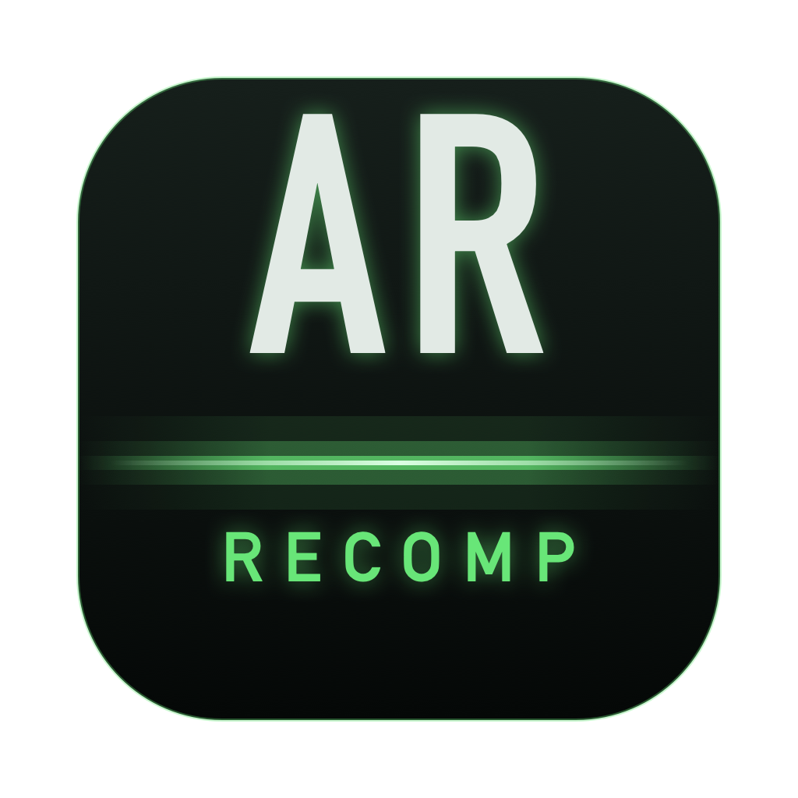

# Alien Resurrection: Recompiled

**The PlayStation's *Alien Resurrection*, running natively on macOS, Windows and Linux**

Alien Resurrection: Recompiled is a native port of *Alien Resurrection*
(PlayStation, USA release SLUS-00633), made by **statically recompiling**
the game's MIPS code. The game runs on a small runtime that stands in for
the PlayStation's BIOS and hardware, and a modern GPU renderer draws it in
high resolution and widescreen, at a steady 60 fps. It adds precision
geometry without the PS1 wobble, mouse and keyboard controls, quick saves
and optional gameplay tweaks.

### [Download the latest release](https://github.com/DiegoDeDios/AlienReRecomp/releases/latest)

> [!IMPORTANT]
> This repository and its releases contain no part of the game, neither
> data nor code. You need your own copy of *Alien Resurrection* (USA,
> SLUS-00633) as a disc image (a `.cue` sheet with its `.bin` tracks) to
> play.

| PlayStation (240p, 4:3) | This port (16:9, 3x resolution, precision geometry) |
| --- | --- |
| 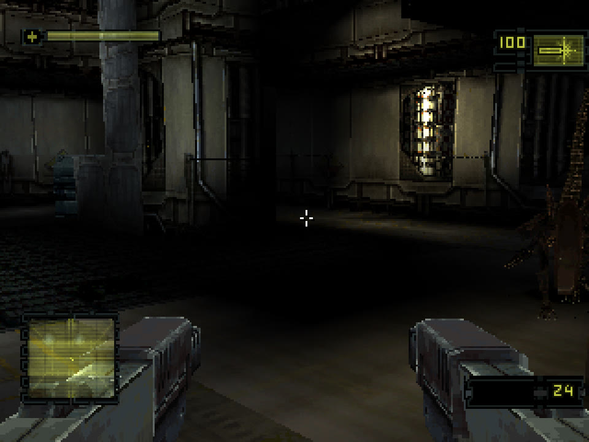 | 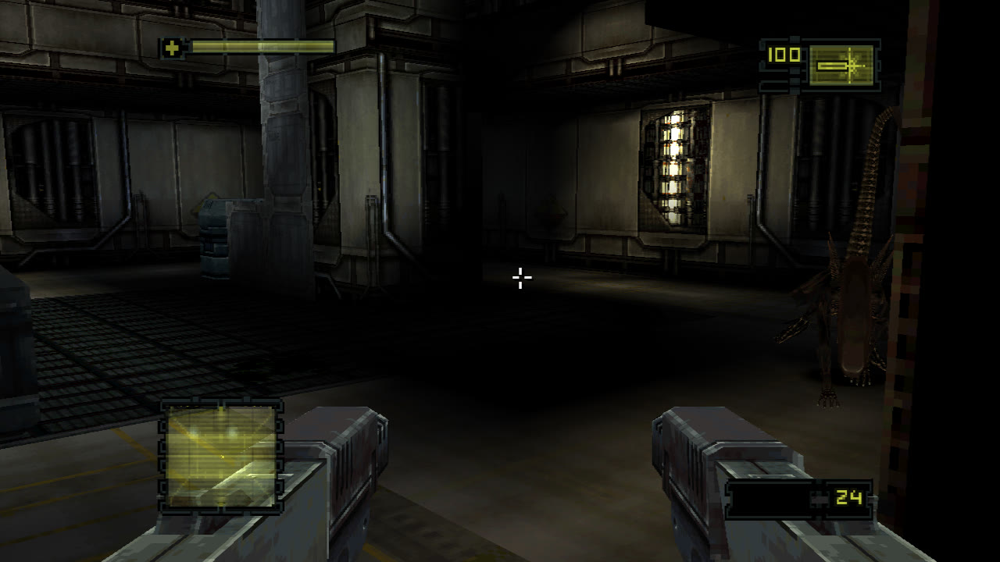 |

*The same frame of the first attract demo. The alien at the right edge is
only fully visible in widescreen.*

## Table of Contents

* [System Requirements](#system-requirements)
* [Getting Started](#getting-started)
* [Features](#features)
  * [Plug and Play](#plug-and-play)
  * [Widescreen and Wider Field of View](#widescreen-and-wider-field-of-view)
  * [High Resolution](#high-resolution)
  * [Precision Geometry](#precision-geometry)
  * [Steady 60 FPS](#steady-60-fps)
  * [Mouse and Keyboard](#mouse-and-keyboard)
  * [Responsive Controls](#responsive-controls)
  * [Quick Save](#quick-save)
  * [Settings Without Leaving the Game](#settings-without-leaving-the-game)
  * [Sprint](#sprint)
  * [Enemy Damage Sliders](#enemy-damage-sliders)
  * [Infinite Flashlight](#infinite-flashlight)
  * [Smaller Changes](#smaller-changes)
* [Controls](#controls)
* [Planned Features](#planned-features)
* [FAQ](#faq)
* [Known Issues](#known-issues)
* [Building](#building)
* [How It Works](#how-it-works)
* [Credits](#credits)
* [License](#license)

## System Requirements

| System | Requirements |
| --- | --- |
| macOS | macOS 11 or later, Apple Silicon or Intel |
| Windows | Windows 10 or 11, 64-bit, a GPU with Vulkan or Direct3D 12 |
| Linux | x86_64 with glibc 2.35 or newer (Ubuntu 22.04, Debian 12, Fedora 36, SteamOS 3 or newer) and a Vulkan driver |

If the game does not start, make sure your graphics drivers are up to date.

## Getting Started

1. Download the package for your system from the
   [latest release](https://github.com/DiegoDeDios/AlienReRecomp/releases/latest)
   and unpack it.
2. Run **AlienResurrection** (`.app` on macOS, `.exe` on Windows,
   `./AlienResurrection` on Linux).
   * macOS: the app is not notarized. On first launch macOS blocks it; open
     *System Settings › Privacy & Security* and choose *Open Anyway*.
   * Windows: SmartScreen may warn about an unrecognized app; choose
     *More info › Run anyway*.
3. Choose **Select disc image** and pick your `Alien Resurrection (USA).cue`.
4. Adjust **Settings** and **Controls** if you like, then **Start game**.

## Features

### Plug and Play

Start the port, choose your disc image (`.cue`, one of its `.bin` tracks or
the folder) and press **Start game**. The launcher checks that it is the USA
release and shows the title art, read from your own disc. Settings and
controls can be changed here or later in game, with the mouse, the keyboard
or a controller.

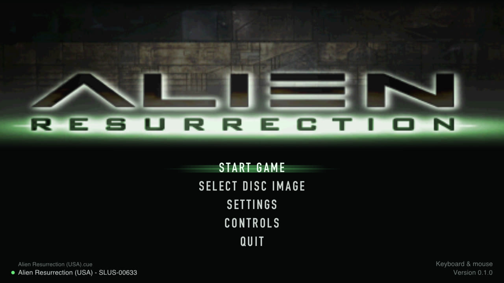

### Widescreen and Wider Field of View

* **Widescreen** at 16:9, 16:10, 21:9 or 32:9 widens the view in 3D instead
  of stretching the picture. The HUD, menus, loading screens and movies keep
  their original 4:3 shapes.
* **Field of view** slider: the game's own view is fairly narrow (53°
  across the screen at 4:3, 67° with 16:9 widescreen); widen it up to 100°.
  The first-person weapon keeps its original framing.

### High Resolution

* **Internal resolution** from the original 240p up to 8x (1920p); 4x by
  default.
* **Smooth or sharp scaling** to the window, fullscreen, and vsync without
  tearing.

### Precision Geometry

The PlayStation rounds every vertex to a whole pixel and maps textures
without perspective correction, which makes polygons jitter and textures
warp as the camera moves. **Precision geometry** (in the spirit of PGXP)
keeps the full precision of every projected vertex and its depth, so
geometry stays still and textures stay straight. Walls that reach past the
camera, which the original draws smeared and bent at the edge of the
screen, are clipped properly. It can be switched off for the original look.

### Steady 60 FPS

On the original hardware busy scenes drop to 20–30 fps. The port runs the
game's code at three times the original CPU speed by default, which keeps
60 fps; the game measures elapsed time itself, so it plays at the same speed
as on the console. The game also capped itself at 20 fps while loading the
next part of a level (from the terminal or door that starts the load until
you walk through); the port stays at 60.

### Mouse and Keyboard

Look and turn with the mouse (adjustable sensitivity), move with WASD, fire
with the left button. Every PlayStation button can be bound to two keys or
mouse buttons and to a controller button on the **Controls** page.
Controllers are detected automatically and start with the PlayStation
layout. F1 releases the mouse; clicking the window captures it again. See
[Controls](#controls) for the default bindings.

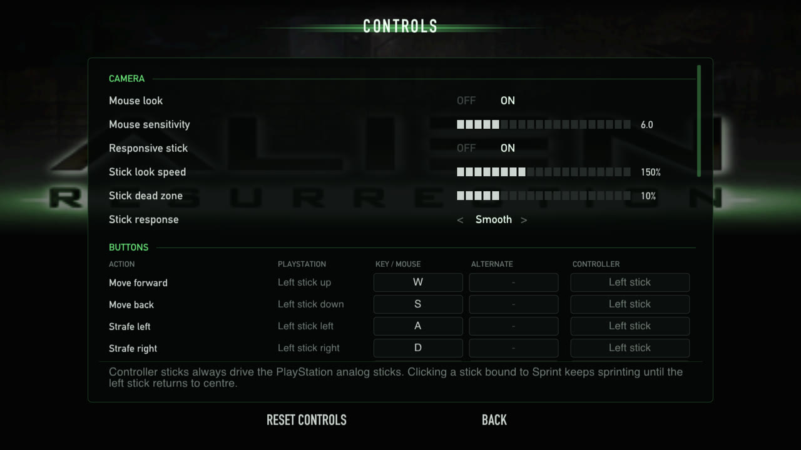

### Responsive Controls

In the original the sticks reach the game two frames late and are ignored
until pushed 38% of the way; the camera stick only sets a turning speed.
The port reads the controls right when the game needs them:

* **Mouse look turns the camera directly**: every mouse movement turns the
  view by exactly that much, immediately, with no dead zone and no speed
  limit.
* **Responsive sticks** (on by default): both sticks, and the move and look
  keys, take effect on the next frame, with a 10% dead zone instead of
  38%. Half a push on the left stick walks at half speed; the camera stick
  has a choice of response curves (Linear, Smooth, Precise) and an
  adjustable speed (150% of the original by default). Turn it off for the
  original handling.

| Sticks, Turn speed 4 | Original | This port (defaults) |
| --- | --- | --- |
| Frames until the camera or Ripley moves | 3 | 1 |
| Stick travel ignored | 38% | 10% |
| Movement with the left stick half pushed | 18% | 45% |
| Full-speed turn | 137°/s | 206°/s |

### Quick Save

The original only saves at the save stations, and loading one puts you back
in front of that station. **Quick save** (on by default) adds one slot
that keeps the exact moment: press **F5** anywhere to save and **F9** to
return to it, with enemies, doors, items and sounds exactly as they were.
It works in the title menu too, so a session can pick up where it left off
right after starting the game. The keys can be changed in **Controls**
(also for a controller), and the pause menu (F2) has **Quick save** and
**Quick load** entries. Memory card saves are not touched.

### Settings Without Leaving the Game

Press **F2** (or hold **Select + Start** on a controller) to pause and open
the settings and controls over the game. Changes apply immediately, except
internal resolution, VSync and skipping the intro, which are marked as
applying on the next start. **Quit to desktop** is there too.

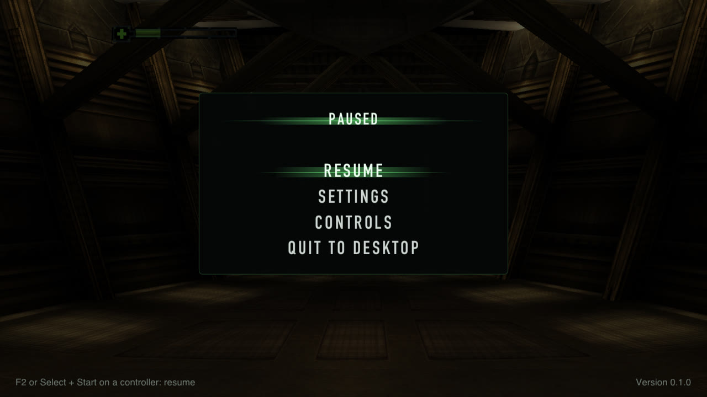

### Sprint

Hold **Shift** (or click the left stick on a controller) to move faster.
Added by this port: the game's own running speed is scaled, so collisions,
doors and slopes behave as usual and the speed ramps up and down smoothly.
190% by default, adjustable from 110 to 250%.

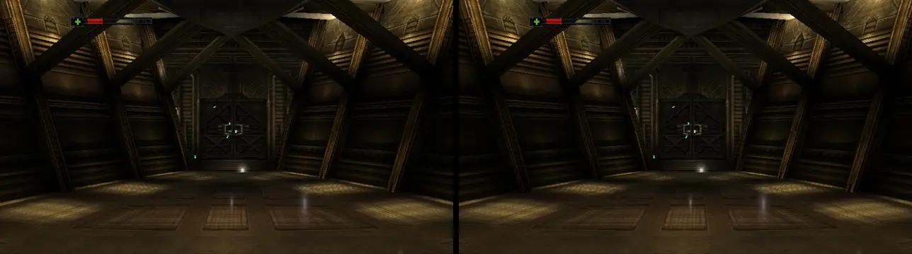

*The same four seconds from the start of level 1: running (left) and
sprinting at 190% (right).*

### Enemy Damage Sliders

Make the game easier or harder: **Settings › Enemy damage** has an
"All enemies" percentage and one for each kind of enemy (alien warriors,
facehuggers, chestbursters, the queen, the Newborn, marines and soldiers,
the sentry tank, and acid blood), from 0 to 200%. The game's own difficulty
setting still applies on top. Falls, drowning and your own explosions are
not affected.

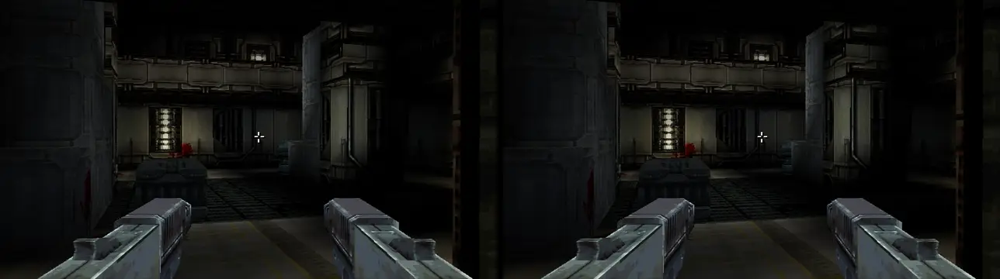

*The same alien attack. Left: original damage, Ripley goes down after five
hits. Right: enemy damage at 50%, she is still standing.*

| Alien warrior hit, Normal difficulty | Health lost | Hits to go down |
| --- | --- | --- |
| 100% (original) | 24% | 5 |
| 50% | 12% | 9 |
| 200% | 48% | 3 |

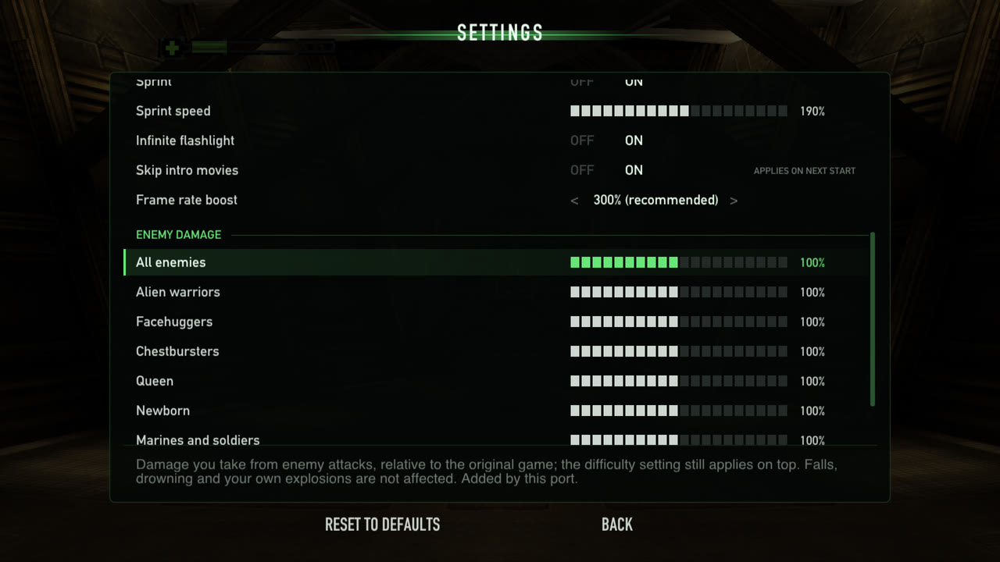

### Infinite Flashlight

The flashlight (from the second level on) normally lasts about 20 seconds
and then has to recharge while switched off. With **Infinite flashlight**
(on by default) the battery never runs down.

| Original, 20 seconds after switching it on | Infinite flashlight |
| --- | --- |
| 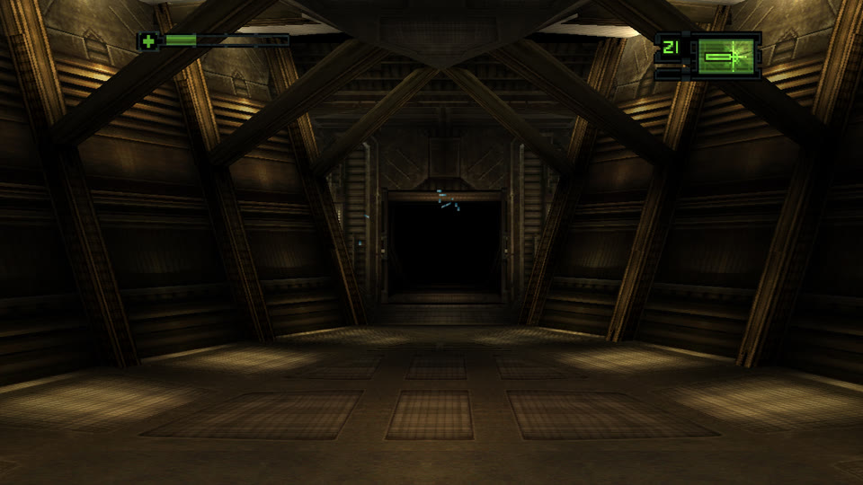 | 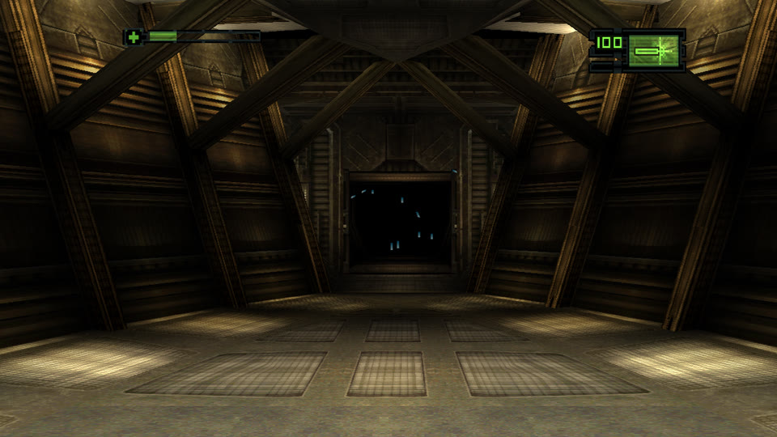 |

### Smaller Changes

* Memory card saves work (save, load, overwrite) and are kept as standard
  memory card images.
* **Skip intro movies** starts straight at the title menu.
* **Fast forward**: hold the backtick key.
* Invert Y is off by default (the original defaulted to on); the game's own
  option still changes it.
* Screenshots with F12.

## Controls

The game uses the DualShock "Dual Stick" scheme (left stick moves and
strafes, right stick looks and turns). Default keyboard and mouse bindings,
all changeable in **Controls**:

| Key | Pad | In game |
| --- | --- | --- |
| W A S D | left stick | move / strafe |
| Shift (hold) | | sprint (added) |
| mouse (click window to capture, F1 releases) | right stick | look / turn |
| arrows | d-pad | menu navigation, look / turn |
| left click / Left Ctrl | R1 | fire |
| right click / F | R2 | action |
| E | Circle | use |
| Space / C | Cross | menu accept, crouch |
| X / Backspace | Triangle | menu back, next item |
| Z | Square | previous item |
| R / Q | L1 / L2 | next / previous weapon |
| Esc / Enter | Start | pause |
| Tab | Select | look hold |
| V / B (middle click) | L3 / R3 | centre view / quick turn |
| ` (backtick) | | fast forward (added) |
| F5 / F9 | | quick save / quick load (added) |

Fixed keys: F2 opens the settings overlay, F11 or Cmd+Ctrl+F toggles
fullscreen (F11 only on Windows), F12 takes a screenshot (Shift+F12 dumps
VRAM), F1 releases the mouse. These can't be bound to game actions. Quit with
Cmd+Q (Alt+F4 on Windows), by closing the window, or with Quit to desktop in
the overlay.

Controllers are detected automatically; their sticks always drive the
analog sticks and the buttons follow the Controls page (default: the
PlayStation layout, left stick click = sprint, which latches until the stick
returns to centre; the game's L3 "centre view" is on V). Holding Select and
Start together opens the overlay; neither button reaches the game then, so
the game's own pause menu stays closed.

## Planned Features

* **High-resolution texture replacement.** The game's art can't simply be
  swapped for bigger images: textures are small 4-bit tiles packed into
  256×256 VRAM pages, each drawn with its own 16-colour palette (see
  [Textures and images](docs/FINDINGS.md#textures-and-images)). The plan,
  as in emulators such as DuckStation, is to dump every texture the game
  draws to PNG (named by a hash of its pixels and palette), let them be
  upscaled or repainted, and have the renderer draw the replacements.
  Full-screen images (loading screens, title art) can be replaced whole.
* **Linux: an AppImage or Flatpak** for desktop integration, and arm64
  packages (they build with `ARCH=arm64 tools/build_linux_docker.sh` but
  are not part of the release yet).

## FAQ

#### What is static recompilation?

Translating a program's machine code into another language ahead of time
instead of emulating it while it runs. `tools/recomp.py` turns each of the
game's roughly 2,000 MIPS functions into a C function, which is compiled
for your computer together with a runtime that replaces the PlayStation's
BIOS and hardware.

#### Why do the downloads interpret the game's code then?

The recompiled C is derived from the game, so it can't be distributed. The
downloads read the game's code from your disc image when you play and run
it with the port's MIPS interpreter, with exactly the same enhancements.
Building from source with your own disc gives you the recompiled version
(see [Building](#building)).

#### Is this an emulator? Can it run other games?

No. The runtime only implements what *Alien Resurrection* uses, and the
port only accepts the USA release (SLUS-00633). Other games, and other
releases of this one, are not supported.

#### Is this based on a decompilation?

No. The port runs the game's original code unchanged; its enhancements are
small native replacements for individual game functions, found by reverse
engineering the game. What has been learned so far is in
[docs/FINDINGS.md](docs/FINDINGS.md).

#### Where are my saves and settings?

Memory cards (standard 128 KiB images), `config.ini` and the quick save
(`quicksave.state`) live in:

| System | Folder |
| --- | --- |
| macOS | `~/Library/Application Support/AlienResurrectionPort/AlienResurrection/` |
| Windows | `%APPDATA%\AlienResurrectionPort\AlienResurrection\` |
| Linux | `~/.local/share/AlienResurrectionPort/AlienResurrection/` (or under `$XDG_DATA_HOME` when set) |

The game keeps its own options (Invert Y, crosshair, vibration…) inside
each memory card save and restores them from the newest save at startup.
Delete `quicksave.state` to start without a quick save; copy it to keep one
aside.

#### Why won't my quick save load after an update?

A quick save is a snapshot of the whole emulated PlayStation (about 4 MB)
and belongs to the version of the port that made it. Before updating, save
at a station; memory card saves carry over.

#### Can I get the original look and feel back?

Yes: in **Settings** turn off Widescreen, Precision geometry, Responsive
sticks, Sprint and Infinite flashlight, and set Internal resolution to 1x,
Field of view to Original and Frame rate boost to Original (100%).

#### Where do I report a bug?

In the [issue tracker](https://github.com/DiegoDeDios/AlienReRecomp/issues).
On Windows, `alien.log` in the save folder (above) has details when the
game fails to start.

## Known Issues

* No rumble output: the DualShock rumble protocol is implemented but not
  passed on to controllers.
* The PlayStation Mouse, which the game supports, is not emulated.
* The Windows build has been verified under Wine and in a Parallels VM, and
  the Linux build in containers; reports from native Windows and Linux
  machines are welcome.
* Not every level has been played through on the port yet.

## Building

Building is not required to play: the
[releases](https://github.com/DiegoDeDios/AlienReRecomp/releases) have
ready-made packages, which contain no game data or code. To build the port
yourself, as a recompiled build from your own disc or as the interpreted
build the releases use, see [docs/BUILDING.md](docs/BUILDING.md). It also
covers the release workflow and the command-line options used for testing.

## How It Works

* `tools/recomp.py` translates every MIPS function of the two game
  executables (the boot loader and `ALIEN.BIN`) into C, one C function per
  MIPS function. Sony's PsyQ library functions are identified by
  signature. Release builds instead interpret the original machine code
  read from the player's disc, calling the same native hooks.
* The runtime (`src/runtime`, `src/hw`) replaces the PlayStation BIOS and
  models the hardware the game and its libraries talk to: GPU, GTE, CD-ROM,
  SPU, MDEC, DMA, timers, controllers and memory cards.
* The renderer (`src/render`) draws the game's GPU commands through the
  SDL3 GPU API (Metal on macOS, Vulkan or Direct3D 12 on Windows, Vulkan
  on Linux), at a multiple of the original resolution.
* The enhancements are small native replacements for individual game
  functions (`src/runtime/native.c`), found by reverse engineering the
  game.

See [docs/ARCHITECTURE.md](docs/ARCHITECTURE.md) for how the port works and
[docs/FINDINGS.md](docs/FINDINGS.md) for what has been learned about the
game so far.

## Credits

* [SDL3](https://libsdl.org) for windows, input, audio and the GPU API.
* [Dear ImGui](https://github.com/ocornut/imgui) for the launcher and the
  in-game overlay.
* [psx_psyq_signatures](https://github.com/lab313ru/psx_psyq_signatures) for
  identifying Sony's library functions.
* [Architecture of Consoles](https://github.com/flipacholas/Architecture-of-consoles)
  by Rodrigo Copetti, for PlayStation hardware reference.
* PGXP, originally by iCatButler for PCSX-R, for the idea behind precision
  geometry.

## License

The port's own source code and documentation are released under the
[MIT License](LICENSE). That covers only what was written for this
project:

* `third_party/imgui` is Dear ImGui, under its own MIT license
  (`third_party/imgui/LICENSE.txt`); SDL3 is used under the zlib license.
* *Alien Resurrection* itself (its code, data, artwork, text, music and
  trademarks) is not covered and not included. The screenshots and
  animations in `docs/media` show the game and remain the property of its
  owners; they are here only to illustrate the port.
* The C code that `tools/regen.sh` recompiles from your disc (`src/gen/`)
  is derived from the game, is not covered by this license and is not part
  of the repository. Recompiled builds contain it and are for personal use;
  the release packages are interpreted builds, which contain no game code
  and read it from the player's own disc image.

This is an independent fan project, not affiliated with or endorsed by 20th
Century Studios, Fox Interactive or Argonaut Games. *Alien Resurrection* and
all related game content belong to their owners; no game data is included.
